<p align="center">
  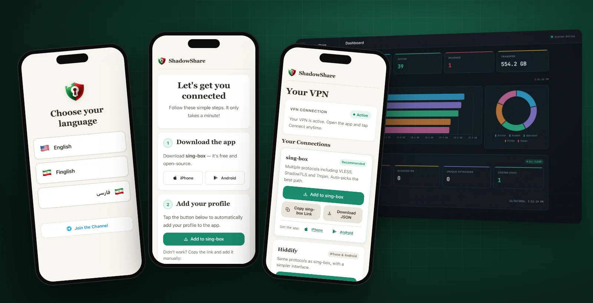
</p>

<h1 align="center">ShadowShare</h1>

<p align="center">
  <b>Self-hosted, invite-only VPN for people behind heavy censorship.</b><br>
  One person runs a server and shares a link. Everyone they trust is connected in about a minute,
  with no accounts, passwords, payments or config files.
</p>

<p align="center">
  <a href="https://github.com/arashvakil/shadowshare/actions/workflows/ci.yml"></a>
  <a href="LICENSE"></a>
  
  
</p>

<p align="center">
  <a href="#quick-start">Quick start</a> ·
  <a href="docs/deploy.md">Deploy guide</a> ·
  <a href="#how-it-works">How it works</a> ·
  <a href="#admin-panel">Admin panel</a> ·
  <a href="CONTRIBUTING.md">Contributing</a>
</p>

---

Public VPN services in Iran, China and Russia get found and blocked within days. ShadowShare takes a different approach: **private networks of trust**. You run a server, invite a few people, and they invite a few more. There's no public sign-up page to find, so the network grows only through people who know each other.

- **About a minute from link to connected.** Open the link, pick a language, tap "Add to sing-box", done.
- **Many protocols in one profile.** VLESS over CDN, Reality, ShadowTLS, Trojan and more. If one gets blocked, the user picks another from the same profile; no re-import needed.
- **Runs on almost nothing.** One $6/month VPS has served thousands of users.
- **Fallbacks for the worst days.** SSH and DNS tunnels for when nothing else gets through, and an MTProto proxy that keeps Telegram working.
- **Built for the people using it.** Native Farsi with right-to-left layout and Finglish, large touch targets, QR codes, one-tap import.
- **Nothing worth seizing.** No emails, no phone numbers, no passwords. Telegram IDs are HMAC-hashed and web tokens are 256-bit.

## How it works

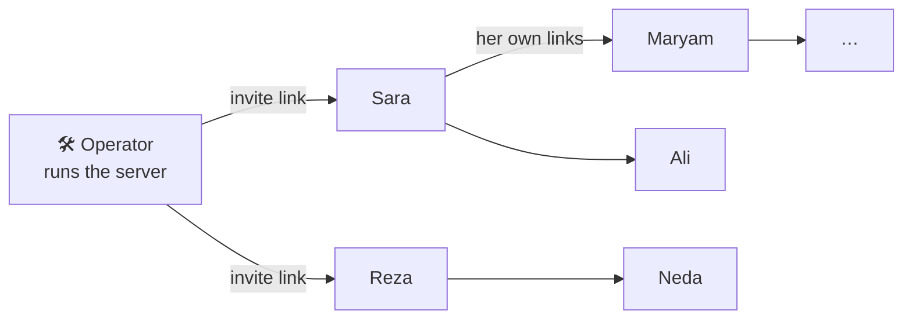

Every invitee gets their own invite links, 10 by default and adjustable in the admin panel. Access spreads person to person, and you can revoke anyone from the admin panel.

<table>
  <tr>
    <td align="center" width="25%">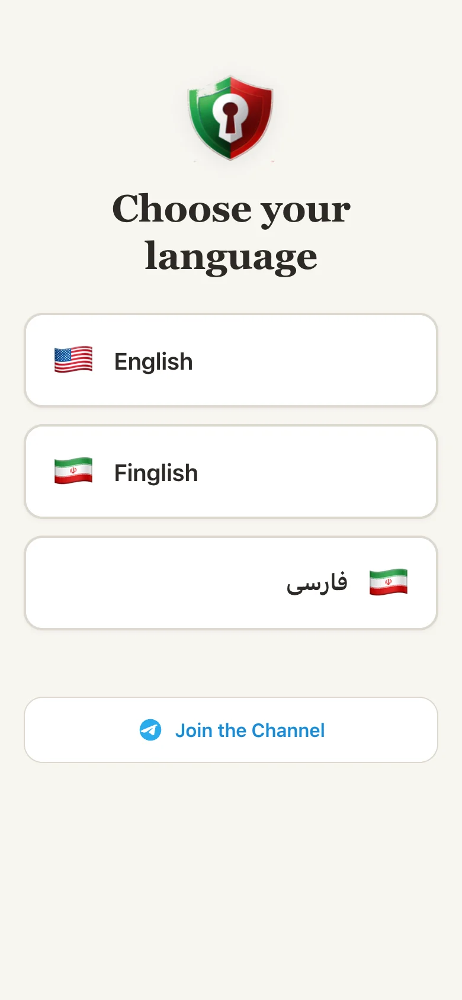</td>
    <td align="center" width="25%">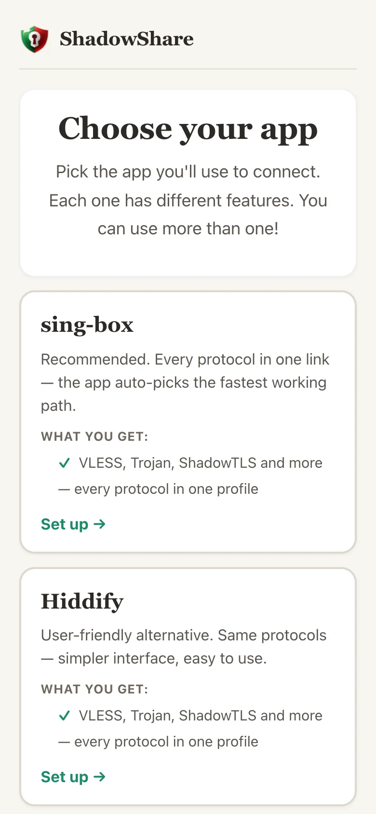</td>
    <td align="center" width="25%">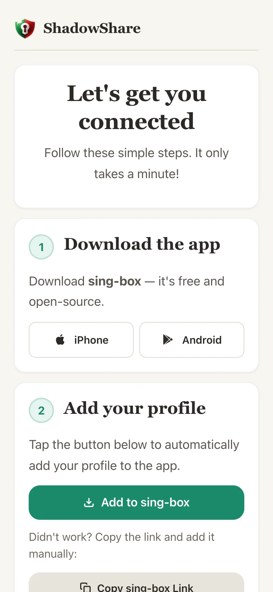</td>
    <td align="center" width="25%">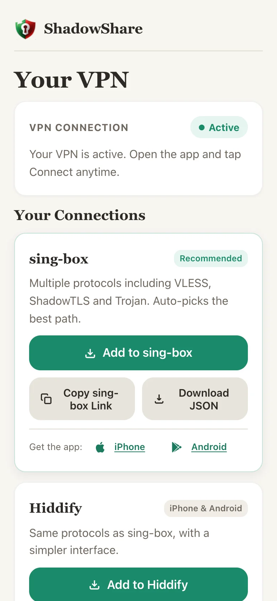</td>
  </tr>
  <tr>
    <td align="center"><b>1. Open the invite</b><br><sub>Pick English, فارسی or Finglish. The invite is redeemed right away.</sub></td>
    <td align="center"><b>2. Choose an app</b><br><sub>sing-box, Hiddify or AmneziaVPN. Free and open source.</sub></td>
    <td align="center"><b>3. One-tap setup</b><br><sub>Install the app, tap "Add to sing-box", and you're connected.</sub></td>
    <td align="center"><b>4. Dashboard</b><br><sub>Every profile, copy button and QR code in one place.</sub></td>
  </tr>
</table>

## Share it with people you trust

<table>
  <tr>
    <td width="50%" valign="top">
      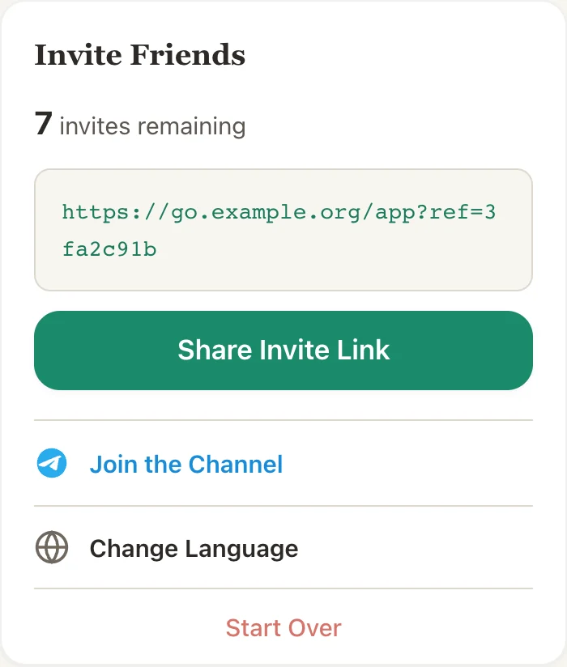
    </td>
    <td width="50%" valign="top">
      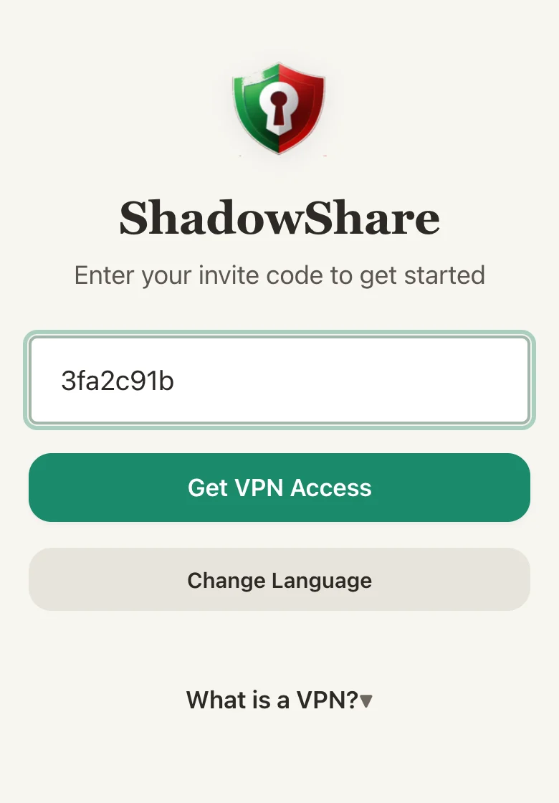
    </td>
  </tr>
  <tr>
    <td valign="top"><b>Invite links</b><br><sub>Each user sees how many invites they have left and shares a link through the system share sheet. The admin sets the default allowance.</sub></td>
    <td valign="top"><b>Or just a code</b><br><sub>When a link can't be opened, someone can type the 8-character code, the <code>ref_</code> form or the whole link.</sub></td>
  </tr>
</table>

### Distribution is the hard part

Running the server is the easy half. Getting access into people's hands is harder. During a shutdown, a URL you paste into a chat can be blocked, the domain behind it can be DNS-poisoned, and the person on the other end may not be able to reach a website at all. So ShadowShare gives you several ways to hand out an invite, and you can use whichever one gets through:

- **A link**, shared through the phone's share sheet.
- **An 8-character code**, which works anywhere text does: SMS, a voice call, a note on paper. The person types it into the web app or the bot.
- **A Telegram bot.** Many people behind heavy censorship already reach Telegram, so the bot meets them where they are:
  - `t.me/YourBot?start=ref_CODE` redeems an invite in one tap, and the bot also accepts a pasted code or link.
  - The whole setup flow runs inside the chat, so the person never has to open the web app. That covers picking a language and an app, getting deep links and config, and reaching the dashboard.
  - `/invite` gives each user a ready-to-forward share message with their link. You set its wording in the admin panel (`bot.shareMessageText`).
  - The built-in MTProto proxy helps keep Telegram itself reachable, so the bot stays usable when Telegram is throttled.

To turn on the bot, create one with [@BotFather](https://t.me/BotFather), set `BOT_TOKEN` and `BOT_USERNAME` in `.env`, and enable `service.bot` in the admin panel.

## When things get blocked

<table>
  <tr>
    <td width="45%" valign="top">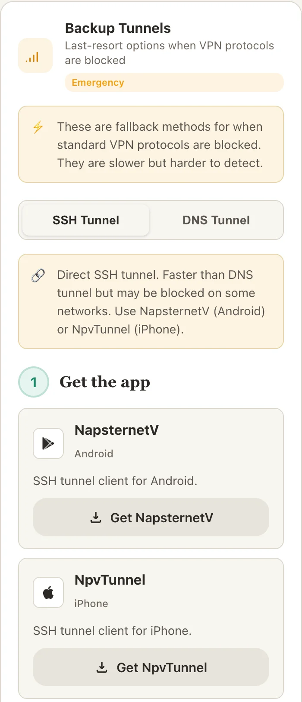</td>
    <td width="55%" valign="top">

Censors detect plain WireGuard and OpenVPN easily, so ShadowShare layers several transports. One sing-box profile carries all of them. Its default <code>auto</code> mode picks a working CDN route, and users can switch to any other connection in the app.

| Transport | Path |
|---|---|
| VLESS + WS / gRPC / XHTTP / HTTPUpgrade | via Cloudflare CDN |
| VLESS + Reality, XHTTP + Reality | direct :443 |
| ShadowTLS v3, Trojan | direct :443, SNI-routed |
| VLESS via Cloudflare Worker | `*.workers.dev` |
| Hysteria2, TUIC | UDP |
| AmneziaWG | obfuscated WireGuard |
| OpenVPN + Cloak | looks like HTTPS |
| SSH tunnel (NPV), DNS tunnels | last resort |
| MTProto proxy | Telegram only |

Every protocol is optional and turns on only when its env vars are set.

</td>
  </tr>
</table>

## In their language

<table>
  <tr>
    <td width="35%" valign="top">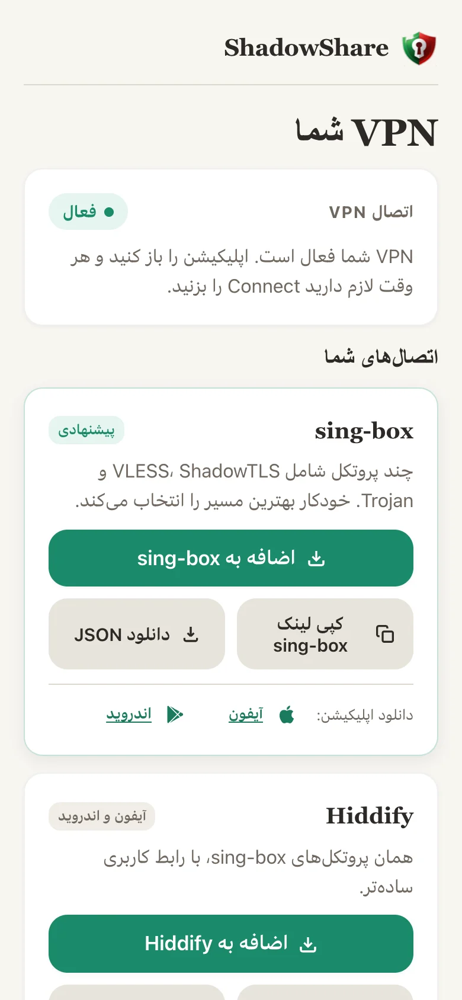</td>
    <td width="65%" valign="top">

Every screen ships in **English**, **فارسی** (full right-to-left layout) and **Finglish**, Farsi written in Latin letters the way many people actually type it.

The web app is plain TypeScript with no framework, about 110 KB. It loads fast on throttled mobile networks and works in any modern browser. An optional **Telegram bot** (grammY) offers the same flow inside Telegram.

**Speak Chinese, Russian, Arabic, Turkish or another language people need?** [Help translate](CONTRIBUTING.md#translations).

</td>
  </tr>
</table>

## Admin panel

<p align="center">
  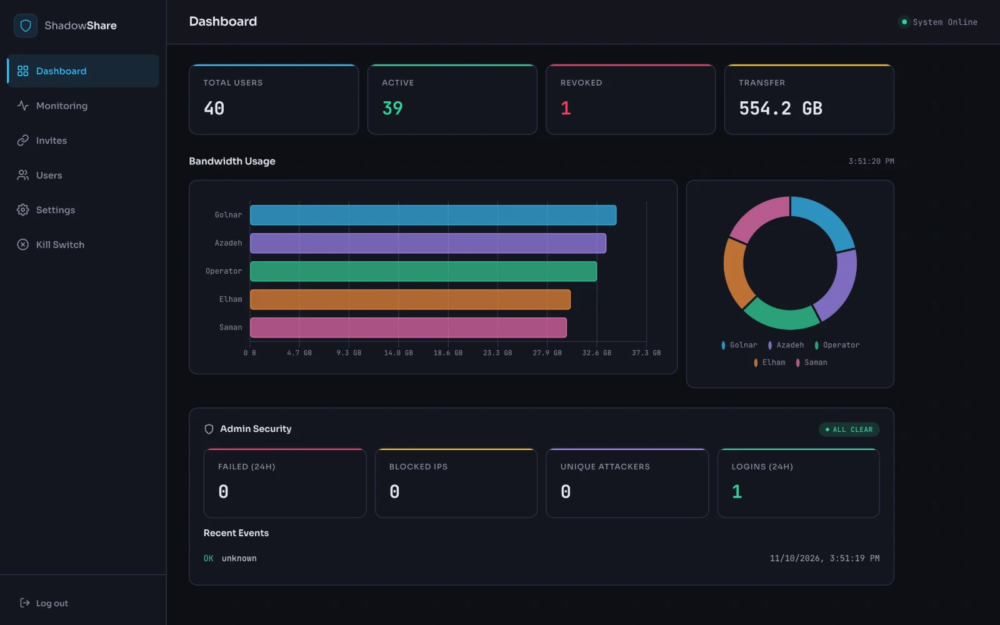
</p>

<table>
  <tr>
    <td width="50%">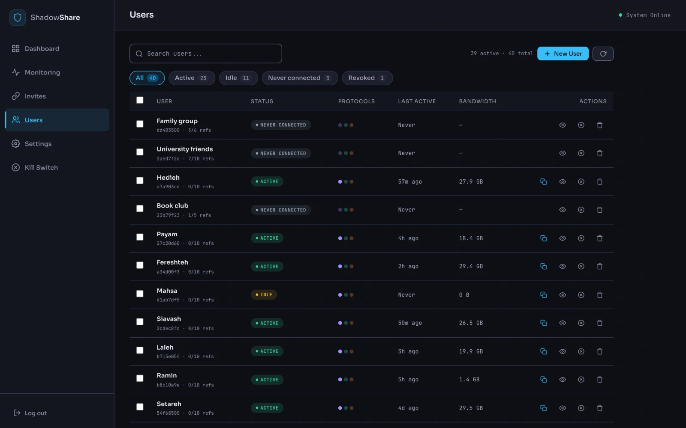</td>
    <td width="50%">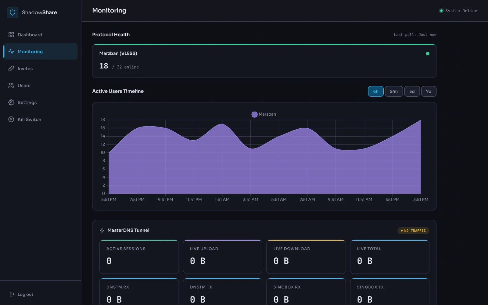</td>
  </tr>
  <tr>
    <td><b>Users</b><br><sub>Filter by Active, Idle, Never connected or Revoked. Per-user bandwidth, last seen, and one-click revoke or restore.</sub></td>
    <td><b>Monitoring</b><br><sub>Online users over time and protocol health. It logs an event when many users drop off at once, which often means a protocol just got blocked.</sub></td>
  </tr>
  <tr>
    <td width="50%">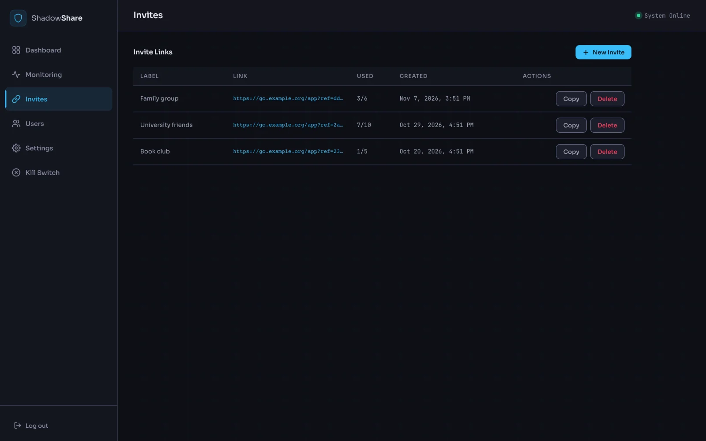</td>
    <td width="50%">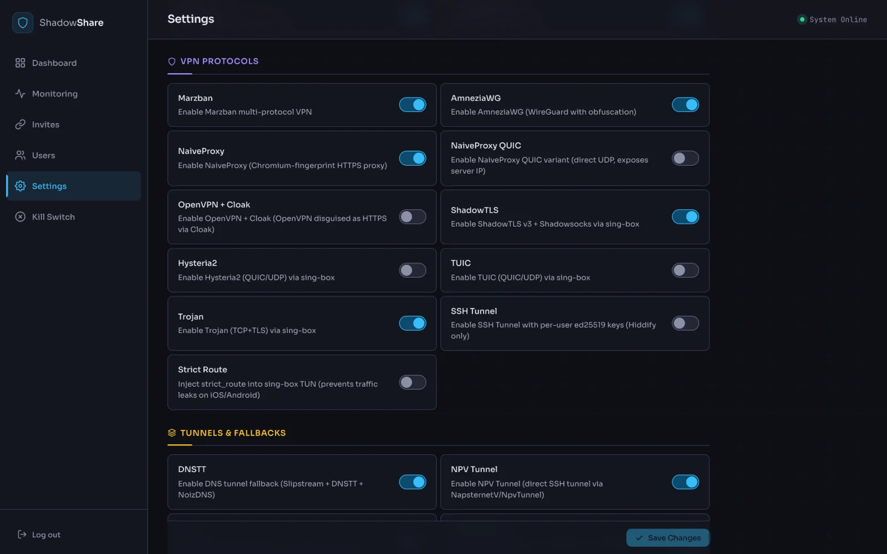</td>
  </tr>
  <tr>
    <td><b>Invites</b><br><sub>Labelled invite links with their own limits, for a family group, a class or a book club.</sub></td>
    <td><b>Feature flags</b><br><sub>Turn protocols, tunnels and sign-ups on or off live, without a redeploy. In an emergency, the kill switch revokes every account and wipes the user database in one step.</sub></td>
  </tr>
</table>

## Architecture

```
Browser / Telegram ─▶ Hono API (:3101) ─▶ provider orchestration ─▶ SQLite (Drizzle)
                      Admin    (:3896)        │
                                              ├─ Marzban / Xray   (VLESS)
                                              ├─ sing-box         (ShadowTLS, Trojan, Hysteria2, TUIC)
                                              ├─ AmneziaWG        (userspace, managed via docker exec)
                                              ├─ OpenVPN + Cloak
                                              └─ dnstm            (DNS tunnels, Dropbear SSH)

Caddy: :80 CDN backends · :443 L4 SNI router · :8443 admin/API/subscriptions
```

## Quick start

You need a VPS with Docker (a $6/month one is plenty), a domain on Cloudflare (the free plan is fine), and about 30 minutes.

```bash
git clone https://github.com/arashvakil/shadowshare.git
cd shadowshare
./setup.sh             # generates every secret, key, path and obfuscation value
# fill in your domains, IP and cover SNIs (setup.sh lists them), then:
docker compose up -d
```

[docs/deploy.md](docs/deploy.md) is the full walkthrough: DNS records, Cloudflare settings, Reality keys, choosing cover SNIs and paths, enabling features in the admin panel, and creating the first invite.

> [!IMPORTANT]
> **No two servers look alike.** Censors fingerprint public defaults, so `setup.sh` gives each install its own transport paths, Reality keys, AmneziaWG parameters, MTProto secret and decoy landing page. Choose your own cover SNIs too, and never reuse another server's values.

## Client apps

| App | Platform | Uses |
|---|---|---|
| sing-box | iOS, Android | Unified subscription (recommended) |
| Hiddify | iOS, Android | Same subscription, friendlier UI |
| V2rayNG / Streisand | Android / iOS | VLESS variants incl. XHTTP |
| AmneziaVPN | iOS, Android | AmneziaWG, OpenVPN + Cloak |
| NapsternetV / NpvTunnel | Android / iOS | SSH tunnel |
| SlipNet / HTTP Injector | Android / iOS | DNS tunnel |

## Development

```bash
npm install
npm run dev            # API + bot with hot reload (needs a .env)
npm run webapp:dev     # web app on :5173, proxies /api to :3101
npm run build          # typecheck + build
npm run db:generate    # new Drizzle migration after schema changes
npm run db:migrate     # apply migrations
npm test               # node:test suite in test/
npm run screenshots    # regenerate docs/images from a seeded demo (after npm run build)
```

The screenshots above come from `npm run screenshots`. It runs the real server against a throwaway database of fictional users, so every name, host and key you see is made up.

See [CONTRIBUTING.md](CONTRIBUTING.md). Security issues: [SECURITY.md](SECURITY.md).

## License

[AGPL-3.0](LICENSE). If you run a modified version as a network service, you must offer its source to your users.
